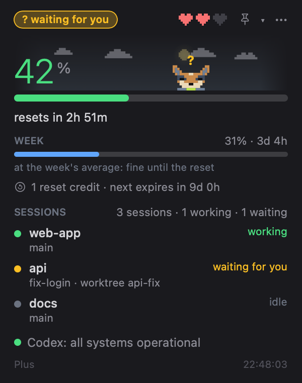
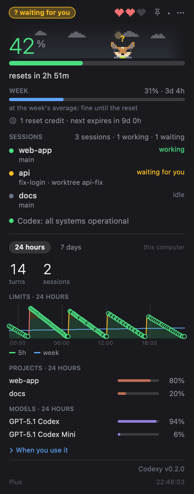
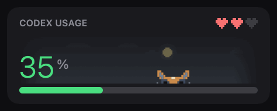

# Codexy

**Your OpenAI Codex plan limits, at a glance in the Mac menu bar.**

Track your 5-hour and weekly limits, see which Codex sessions need you, and keep Theo — a pixel blue heeler that reacts to your activity — nearby. Built with Swift and SwiftUI, with no third-party dependencies.

<p align="center">
  
  
</p>

<p align="center">
  <a href="https://github.com/juliobianco/codexy/releases/latest">Download for macOS</a> ·
  <a href="#install">Install</a> ·
  <a href="docs/GUIDE.md">User guide</a> ·
  <a href="CHANGELOG.md">Changelog</a> ·
  <a href="CONTRIBUTING.md">Contribute</a>
</p>

Built from [Claudy Usage](https://github.com/juliobianco/claudy-usage-mac), the same widget for Claude Code, with English and Brazilian Portuguese support.

> A fan project, unaffiliated with OpenAI. Codex belongs to OpenAI.

**Latest release: [v0.2.0](https://github.com/juliobianco/codexy/releases/tag/v0.2.0).** A tokens-per-day window and the exact state of each session, read from Codex's own app-server. 0.1.0 brought the limits, sessions, usage by project and model, a heatmap, OpenAI status and the Codex version check. See the [release notes](CHANGELOG.md#020---2026-10-22).

## Install

**Requirements:** macOS 14 or later and the Codex CLI installed and logged in. Release downloads support both Apple silicon and Intel.

### Homebrew

```sh
brew trust juliobianco/tap      # once: recent Homebrew ignores casks from taps you have not trusted
brew install --cask juliobianco/tap/codexy
```

The [Homebrew tap](https://github.com/juliobianco/homebrew-tap) installs the release app and clears its download quarantine. The app is ad-hoc signed and **not notarized**.

### Download the app

1. Download `Codexy-<version>-macos.zip` from the [latest release](https://github.com/juliobianco/codexy/releases/latest).
2. Unzip it and move `Codexy.app` to `/Applications`.
3. Open the app. If macOS blocks it, go to **System Settings → Privacy & Security → Open Anyway** after the first attempt.

You can also clear the quarantine in Terminal:

```sh
xattr -dr com.apple.quarantine /Applications/Codexy.app
```

Each release includes a `.sha256` file. Compare it with `shasum -a 256 Codexy-<version>-macos.zip` to verify your download.

### Build from source

Requires Xcode or its command line tools with Swift 6.

```sh
git clone https://github.com/juliobianco/codexy.git
cd codexy
./scripts/bundle.sh
open ~/Applications/Codexy.app
```

The script builds outside `~/Documents` to avoid macOS file attributes that interfere with signing, then installs the app in `~/Applications`.

## Get started

Click the **menu bar icon** to open the panel; the app has no Dock icon.

- Check the **5-hour and weekly bars** for usage and reset times. Numbers refresh every minute, or every 20 seconds once either limit reaches 90%.
- Open **▾ details** for 24-hour stats, the weekly quota-cycle chart and project breakdowns. History builds up from your first launch.
- Click the **pin** to put a floating widget on your desktop. Fold it into a bubble for a smaller view.
- Open **⋯ → Settings…** to choose a theme, language, mascot and label style. Enable **Launch at login** under **System**.
- Open **⋯ → Tokens per day…** for tokens by model over 7 or 30 days.

Location is optional and only used for the weather behind Theo. You can decline access or set a fixed place in Settings.

## Features

| Feature | What you get |
|---|---|
| **Plan limits** | 5-hour and weekly usage with reset countdowns, reset credits and paid credits when your plan has them, and extra limits when Codex reports separate ones. |
| **Live sessions** | Running Codex sessions with project, branch, worktree and working / waiting / idle state, read from Codex's app-server. |
| **Pace** | "At this pace: 100% at 16:07" under the 5-hour bar, and "at the week's average" under the weekly one. A notification when you will hit the 5-hour limit within the hour (on by default, one switch to turn it off). |
| **Alerts** | A blinking **?** when a session needs you and confetti when a limit resets. Notifications for a waiting session and for a reset are optional and off by default. |
| **Usage history** | 24-hour and weekly charts with marks for resets and for reaching 100%, project and model shares for the last 24 hours or 7 days (click a project for its models and busiest hours), an hour-by-day heatmap. Export it as CSV from the ⋯ menu. A "Tokens per day" window charts real token counts by model for 7 or 30 days. |
| **Floating widget** | A movable card that folds into a two-ring bubble, with opacity and always-on-top controls. |
| **Theo and the sky** | Four pixel mascots (Theo, Bit, Coruja and Livrinho), themes, local weather, sunrise, sunset and moon phases. Draw your own as a text file. |
| **Status and updates** | OpenAI status for Codex with the affected components, a warning when the usage read keeps failing, plan information, and the Codex version with a notice when a newer one is out. |

<p align="center">
  
  
</p>

Screenshots use demo data; animations use scripted data. Explore the [full guide](docs/GUIDE.md) for more screenshots, settings, the mascots' moods and [your own mascot](docs/CREATING-ART.md).

## Privacy and security

The app reads limits from your local Codex install: `codex app-server` over stdio (`account/rateLimits/read`), falling back to the last session file in `~/.codex/sessions`. It uses your existing Codex login and has no separate account; it does not read `auth.json`, tokens or API keys. The limits call runs without a model call or token spend.

Session, project and token statistics are counted locally from Codex's own files, reading only counts, model names and folders. Prompts and answers are not read or kept, and there is no analytics. Network requests cover OpenAI's status page, the Codex version check on GitHub and optional Open-Meteo weather using coordinates.

Codexy never changes your Codex settings and never runs `codex` updates: it only shows the command.

## Updating

- **Homebrew:** run `brew update`, then `brew upgrade --cask codexy`.
- **Download:** replace the app with the zip from the [latest release](https://github.com/juliobianco/codexy/releases/latest).
- **Source:** run `git pull`, then `./scripts/bundle.sh`.

There is no automatic self-update. See the [changelog](CHANGELOG.md) for release notes.

## Troubleshooting

| Problem | What to check |
|---|---|
| **Homebrew says "untrusted tap"** | Run `brew trust juliobianco/tap` once, then install or upgrade again. |
| **`brew upgrade` says the cask is not installed** | The app came from a local build or a download. Run `brew install --cask juliobianco/tap/codexy` (remove `~/Applications/Codexy.app` first if you built it). |
| **macOS blocks the app** | Follow the [first-open instructions](#download-the-app); the download is not notarized. |
| **The app does not open right after `brew install`** | The cask tries to open it and macOS sometimes refuses (`kLSUnknownErr`). Run `open -a Codexy`. |
| **Usage shows `--` or “no data”** | Check that `codex` is installed and logged in, then **Settings → System → Open log**. Failed probes retry and keep the last known values marked *stale*. |
| **The chart looks empty** | History starts on first launch and fills as the app runs. |
| **A session is missing** | Only threads Codex has loaded (its app-server) or has a session file open for appear. |
| **No extra limits or credits row** | They appear only when Codex reports them for your plan. |

More diagnostics and known limitations are in the [guide](docs/GUIDE.md#troubleshooting). Real-use checks still open are in [docs/STATUS.md](docs/STATUS.md) and the [roadmap](ROADMAP.md).

## Development and contributing

Mascots, translations, bug reports and code contributions are welcome. Start with [CONTRIBUTING.md](CONTRIBUTING.md) for build and test commands.

- [User guide](docs/GUIDE.md) — detailed features, settings, animations and troubleshooting.
- [Developer reference](CLAUDE.md) — source layout, build commands and implementation notes.
- [Screenshot and GIF tools](docs/GUIDE.md#development) — generate images with demo data.
- [Creating art](docs/CREATING-ART.md) — your own mascot as a text file.
- [Roadmap](ROADMAP.md) — planned work.
- [Status and backlog](docs/STATUS.md) — what is done, what was checked live and what is next.

## Credits and license

Built on [Claudy Usage](https://github.com/juliobianco/claudy-usage-mac), a Swift port of [Enhed/clawd-usage-winwidget](https://github.com/Enhed/clawd-usage-winwidget) by [@Enhed](https://github.com/Enhed), including its porting notes, animation and sky and weather logic.

Released under the [MIT license](LICENSE), with the original copyright notice preserved. Codex is OpenAI's; this project is not affiliated with or endorsed by OpenAI.
