# Codexy guide

Detailed reference for the panel, floating widget, Theo and the other mascots, settings and data sources.
For requirements and installation, see the [README](../README.md#install).

[Panel](#what-it-shows) · [Widget](#floating-widget) · [Mascots](#theo-and-the-other-mascots) · [Tokens](#tokens-per-day) · [Settings](#settings) · [Your own art](#your-own-mascot) · [Data sources](#where-the-data-comes-from) · [Privacy](#privacy-and-security) · [Troubleshooting](#troubleshooting) · [Development](#development)

## What it shows

Click the menu bar item and a card drops down.

<p align="center">
  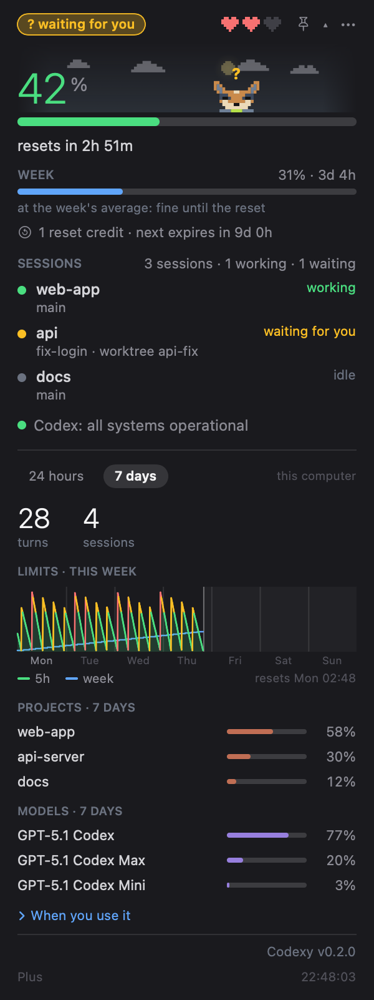
</p>

- **Menu bar label** — two mini bars, `5h` and `W`, in the colour of their level. In Settings you can switch to bars with numbers, or numbers only.
- **Big number** — the 5-hour window, straight from Codex. The bar goes green → yellow → red at levels you choose (default 60% and 85%). Under it, *resets in 2h 51m* and the pace forecast.
- **Hearts** — the mascot's health: how much of the 5-hour limit is left. Each half heart is about 16.7%.
- **WEEK** — the weekly limit with the time to reset and the weekly pace.
- **Extra limits** — when Codex reports other buckets (a model or feature with its own limits), one line each; and *Limit reached: …* when Codex says which limit stopped you. Plus plans report only the main bucket today.
- **Credits line** — the reset credits you have (each one starts your limits over early; you use it in Codex, Codexy only counts them and shows when the next one expires) and paid credits, only when there is something to show.
- **SESSIONS** — every Codex session that is loaded right now, with the **project, the git branch, the worktree** and the thread name, and whether it is *working*, *waiting for you* or *idle*. Handy for catching a forgotten agent burning your limit.
- **Service status** — green *Codex: all systems operational*, or yellow/red with the open incident and the affected components (Codex Web, Codex API, CLI, VS Code extension). A click opens status.openai.com.
- **Plan line** — your plan (Plus, Pro…) and the time of the last answer, marked *stale* if it is old. When the numbers come from the last session file instead of Codex, it says so.
- The **▾** opens the details:
  - **24 hours / 7 days** switch, with the number of turns and sessions.
  - **Limits chart** — the 5-hour percentage (green, filled) and the weekly one (blue). On **24 hours** it shows the last day; on **7 days** it shows the **quota's own cycle**, from the last reset to the next. Marks show resets and the moments a limit reached 100%. Hover for the time and both percentages.
  - **Projects** — which projects spent the most, counted from Codex's own session files (tokens weighted by the model's price; a git remote names the project, worktrees count for their repo). Click one for its models and busiest hours.
  - **Models** — the share by model. It is an estimate of weight, not tokens: OpenAI does not say how each model counts against the plan.
  - **When you use it** — an hour-by-day heatmap.
  - **Footer** — the Codex version, with *update available* when GitHub has a newer release, and Codexy's own version.
- **Alerts** — when a session is **waiting for you** the menu bar label gets a yellow **?** that blinks, the card's title becomes a pulsing *waiting for you* pill and the bubble's rim pulses; when a limit **starts over** the mascot celebrates and confetti falls for a few seconds. Optional macOS notifications for each (off by default). A notification when you will hit the 5-hour limit within the hour is on by default.
- **⋯ menu** — refresh now, export CSV, tokens per day, settings, floating widget, launch at login, quit. The **pin** puts the widget on the screen.

## Floating widget

<p align="center">
  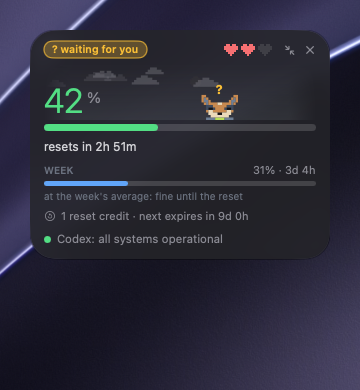
  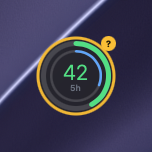
</p>

<p align="center">
  
</p>

The dropdown's compact card — the sky, the mascot, the 5-hour number, the week, the sessions, the status — in its own window that floats over everything and can be put **anywhere**. Its position is remembered, and it comes back when the app starts.

- It **folds into a bubble** with two rings (5h outside, the week inside) around the 5-hour number, and unfolds again. On macOS 26 and later the card and the bubble are **Liquid Glass** and morph into each other.
- It **inflates out of the dropdown** like a bubble when you press the pin, and shrinks back into the bar when you close it.
- Options in Settings → Menu bar: show it, always on top, Liquid Glass or the theme's solid background, opacity. Right-click it for the same switches.

## Theo and the other mascots

Theo is a pixel blue heeler, drawn from the owner's dog. Bit (a robot), Coruja (an owl) and Livrinho (a book) are the other three; pick one in Settings → Look → Mascot. Their mood follows your sessions and your limits:

| situation | the mascot |
|---|---|
| no Codex session is running | burrows into the sand and sleeps, "z"s float up |
| sessions are idle | wanders, looks around, follows your cursor; after a few seconds standing still, Theo sits |
| 10 minutes with no mouse over it | dozes standing up |
| a session is working | runs edge to edge, dust flying (Theo walks in side view, turning with the direction) |
| a session is waiting for you | wide eyes, jumps, a yellow **?** above |
| a session just finished | crouches and throws its arms up |
| you click it | a random animation (jump, spin, peekaboo, wink…) and a heart |
| the 5-hour window resets | celebrates, a green **!**, confetti |
| the 5-hour bar is above the red level | sweats and darts its eyes |
| the 5-hour bar is at 100% | lies belly-up with X eyes |

The less limit left, the slower and sleepier it gets. Each mascot has four faces: normal, slack (low use), crit (near the limit) and sleep.

Behind it is a **sky** that follows the real sunrise and sunset where you are: the sun moves along an arc, at night there is the moon **in its real phase** and twinkling stars. The weather ([Open-Meteo](https://open-meteo.com), no key) adds clouds drifting with the wind, drizzle, rain, showers, snow that settles under its feet, fog and thunderstorms. Hover the sky for the place, temperature, weather, wind, sunrise, sunset and the moon's phase.

<table>
<tr>
<td align="center">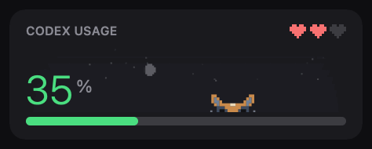<br><sub>Nothing runs: it burrows into the sand and sleeps</sub></td>
<td align="center">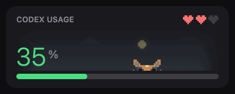<br><sub>Click it: a random animation and a heart</sub></td>
</tr>
<tr>
<td align="center">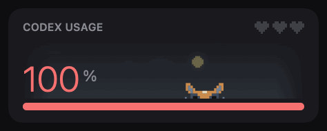<br><sub>Limit at 100%: belly-up</sub></td>
<td align="center">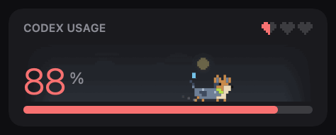<br><sub>The 5-hour window resets: celebration and confetti</sub></td>
</tr>
<tr>
<td align="center">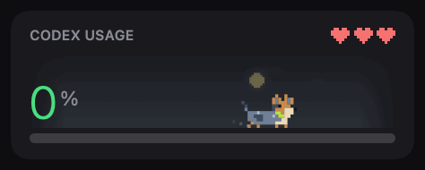<br><sub>Hearts are its health: less limit left, slower and sleepier</sub></td>
<td align="center">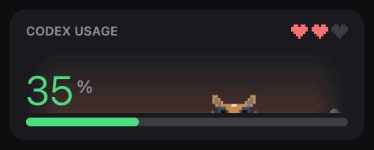<br><sub>The sky follows the time of day and the weather</sub></td>
</tr>
</table>

<p align="center">
  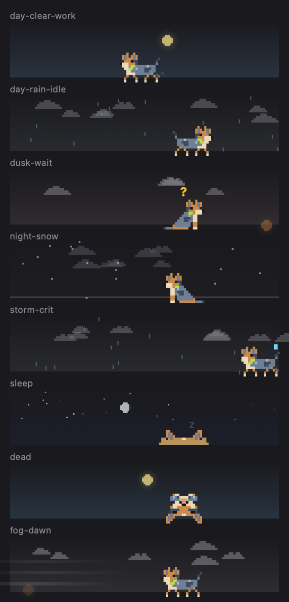
</p>

**Developer menu:** right-click the sky in the open panel to force a mood, play any move, set the hearts, the time of day or the weather. *Auto* goes back to live data.

## Tokens per day

**⋯ → Tokens per day…** opens a window of its own: one stacked bar per day, a colour per model, for the last 7 or 30 days. Hover a day for the split. Under the chart, each model's total with its input, output and cached input.

It is a real token count (input plus output, reasoning included), counted on this Mac from Codex's own session files, the same scan as the details. The shares under Details are an estimate of weight; this window is tokens. The models beyond the first five are grouped as *other models*. Days are your local days.

## Settings

**⋯ → Settings…** opens a window with three tabs, in the language and theme you choose; everything applies at once.

<p align="center">
  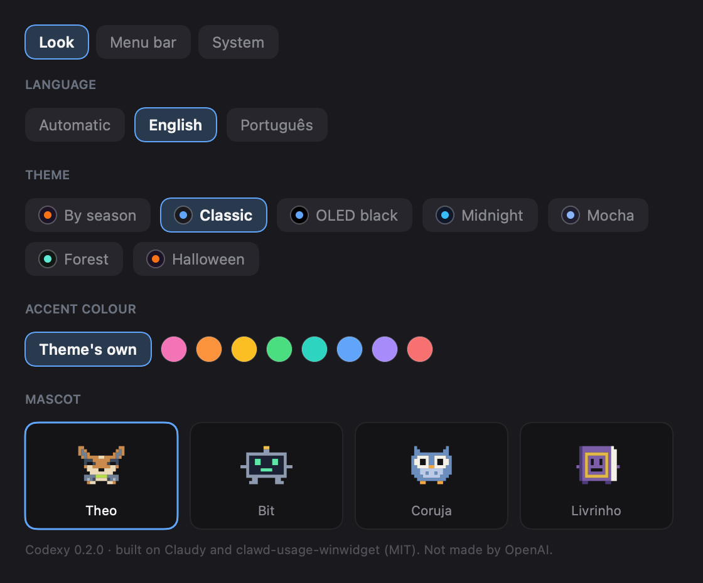
  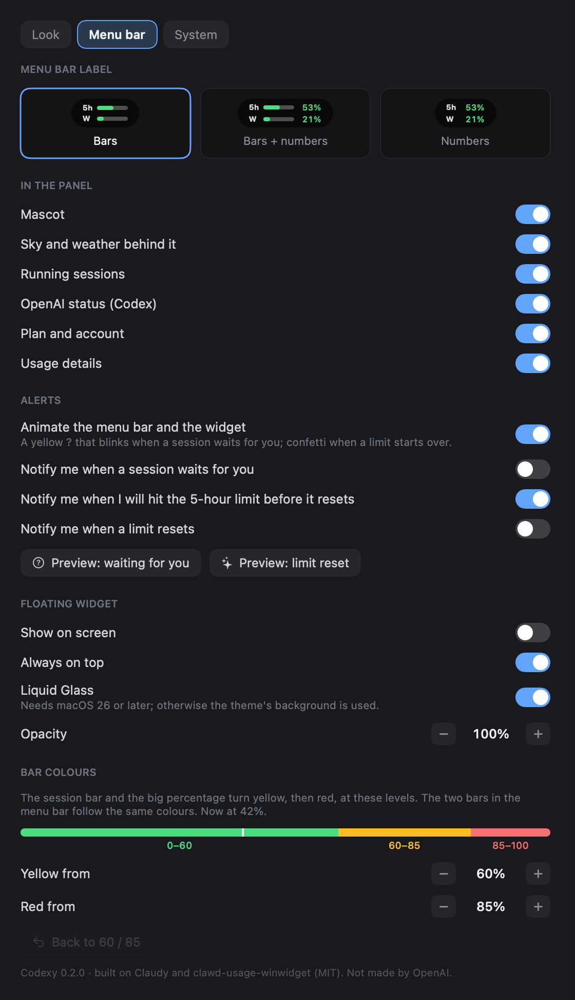
</p>

- **Look** — language (Automatic, English, **Português**), theme (*Classic, OLED black, Midnight, Mocha, Forest, Halloween*, or *By season*), an accent colour, and the **mascot** as cards with a live preview.
- **Menu bar** — the label style, the **floating widget** switches, what the panel shows (the mascot, the sky and weather, sessions, status, plan, the details), and the **bar colours**: the levels where the bars turn yellow and red, with a live scale.
- **System** — launch at login, the weather place (automatic from the system's location, or a fixed latitude and longitude), clearing the 7-day history, opening the log and the data folder.

## Your own mascot

A mascot is a plain text file on an 18 × 12 grid with up to four faces and optional side poses. Drop yours in `~/Library/Application Support/Codexy/pets/` (the same name replaces a built-in one) and pick its card in Settings → Look:

```
---
name: Bit
b: #8E9AAF
---
[normal]
...
```

[**docs/CREATING-ART.md**](CREATING-ART.md) is the longer guide to the pixel grid, animations and the sky. Preview a pet from the command line with `CODEXY_PET=<id>` and `--scenes`, or render every pet in every mood with `--pets DIR`.

## Where the data comes from

| what | source | how often |
|---|---|---|
| limits, plan, credits | `codex app-server` over stdio: `account/rateLimits/read` (no model call). Fallback: the last `token_count` event of the newest `~/.codex/sessions/**/rollout-*.jsonl` | every 60 s; every 20 s at 90% 5h or weekly usage; after wake |
| running sessions | Codex's app-server daemon (`~/.codex/app-server-control/app-server-control.sock`): the loaded threads and their exact state. Fallback: the rollout files a `codex` process holds open | every 5 s |
| project, branch, worktree | the `.git` of each session's folder, read directly | with the sessions |
| project, model and token stats | Codex's rollout files in `~/.codex/sessions` and `archived_sessions` (`.jsonl.zst` read with `zstd` if installed) | when the details are open, every 15 min; the tokens window scans when it opens |
| Codex version | `codex --version`, and GitHub `openai/codex` releases | every 6 hours |
| service status | `status.openai.com` (the Codex group) | every 2 min |
| weather | `api.open-meteo.com` (latitude and longitude only) | every 10 min |
| the limits history | each answer, saved by the app | each answer |

`codex app-server` answers in under a second. If it does not answer, the app falls back to the last session file, says so, and tries again.

## Privacy and security

- **No credentials.** The app never reads `auth.json`, your tokens or an API key, and has no login of its own. `codex` finds its own login.
- **Nothing is uploaded and there is no analytics.** The only network calls are the ones in the table above, to OpenAI's status page, GitHub (the Codex version) and Open-Meteo (a latitude and longitude, no identifier).
- **Location is optional.** The system's location, with your permission, is used only to ask Open-Meteo for the weather. You can refuse and type a fixed place instead.
- **Your sessions stay local.** Reading `~/.codex/sessions` only picks session headers, model names and token counts; lines of conversation are skipped without being decoded, and nothing from them is kept.
- **It changes nothing it was not asked to.** Codexy never writes to your Codex files and never runs a Codex update: it shows the command.
- **No self-update.** Update with Homebrew, download a new release, or pull the code and rebuild; see [Updating](../README.md#updating).
- **What it stores**, all in your user folders: `~/Library/Application Support/Codexy/` (the limits history, your own mascots), `~/Library/Logs/Codexy.log` (probe failures), and the app's preferences (`defaults read dev.julio.codexy`).

## Not in this version

- **A `config.toml` view.** Planned, read-only first.
- **Side poses for Bit, Coruja and Livrinho** (they walk facing forward), and accessories for the new heads.
- **Sessions of the Codex desktop app.** They show if the app uses the same app-server daemon; not checked.
- **Waiting for you with approvals on**, reset credits and extra limits with real values, and project weights against the 5-hour bar are built and tested with fixtures but not yet seen with real use. See [docs/STATUS.md](STATUS.md).
- The download is not notarized (no Apple Developer ID): see [Install](../README.md#download-the-app).

## Troubleshooting

- **The number shows `--` or "no data"** — check that `codex` is installed and logged in. The panel shows why the read failed under the number, and `~/Library/Logs/Codexy.log` has the details (**Settings → System → Open log**). The last numbers stay on screen, marked *stale*.
- **Launched from Finder, `codex` is not found** — a menu bar app starts with a bare PATH; Codexy looks in `~/.local/bin`, Homebrew and `/usr/local/bin`.
- **"from a session file"** — the app-server did not answer, so the numbers are from your last Codex turn. A window whose reset already passed shows 0%.
- **The chart is nearly empty at first** — the history starts the day you first run the app, and fills in as it runs.
- **A session is missing** — only threads loaded in Codex's app-server, or with a session file a `codex` process holds open, appear. Sub-agents and internal reviews are hidden on purpose.
- **Projects or the tokens window are empty** — they read `~/.codex/sessions`; if your older sessions are `.jsonl.zst`, install `zstd`.
- **Nothing happens when I build in `~/Documents`** — use `./scripts/bundle.sh`; it builds elsewhere on purpose.

## Development

```sh
S=$HOME/Library/Caches/codexy-build
swift build --scratch-path $S
swift test  --scratch-path $S           # the core's unit tests
./scripts/bundle.sh                     # builds, signs and installs ~/Applications/Codexy.app
./scripts/make-icon.sh                  # redraws Resources/AppIcon.icns from the code
./scripts/package.sh                    # dist/Codexy-<version>-macos.zip + .sha256, universal
```

The code is two targets: `CodexyCore` (no UI: the Codex readers, sessions, history, the rollout scanner, the mood machine, the sky) and `CodexyUsage` (SwiftUI: the menu bar, the card, the settings, the floating widget, the tokens window). Read [CLAUDE.md](../CLAUDE.md) first: the layout, the commands, and the problems that already cost time.

Pictures without screen-recording permission, and with made-up data (nothing real on the screen):

```sh
export CODEXY_DEMO=1 CODEXY_VERSION="$(cat VERSION)" CODEXY_NO_FLOAT=1
$S/debug/CodexyUsage -language en --readme out/        # the panel, the settings, the mascot in eight situations
$S/debug/CodexyUsage -language en --float-test out/    # opens the real floating window and captures it
$S/debug/CodexyUsage -language en --gifs out/          # the animated GIFs of the mascot (scripted, seeded)
$S/debug/CodexyUsage -language en --float-gif out/     # a GIF of the real floating widget (unset CODEXY_NO_FLOAT)
$S/debug/CodexyUsage --snapshot out/                   # panel.png + bar.png with live data
```

`CODEXY_PET=<id>` picks the mascot, `CODEXY_DETAILS=1` opens the details in a snapshot. Never put real project names, branches, session names or paths in a picture.

Other documents: [ROADMAP.md](../ROADMAP.md), [CONTRIBUTING.md](../CONTRIBUTING.md), [docs/STATUS.md](STATUS.md) (done, checked live, next), [docs/CREATING-ART.md](CREATING-ART.md).

## Versions and news

The version is in the [`VERSION`](../VERSION) file (semantic versioning); `bundle.sh` writes it into the app, and you see it in the details footer and in Settings. What changed in each version is in [**CHANGELOG.md**](../CHANGELOG.md). Each release is a tag (`vX.Y.Z`) with a GitHub Release whose notes are the changelog's entry and whose zip is the app; **Watch → Custom → Releases** on GitHub tells you when there is a new one. For each installation method, see [Updating](../README.md#updating).
